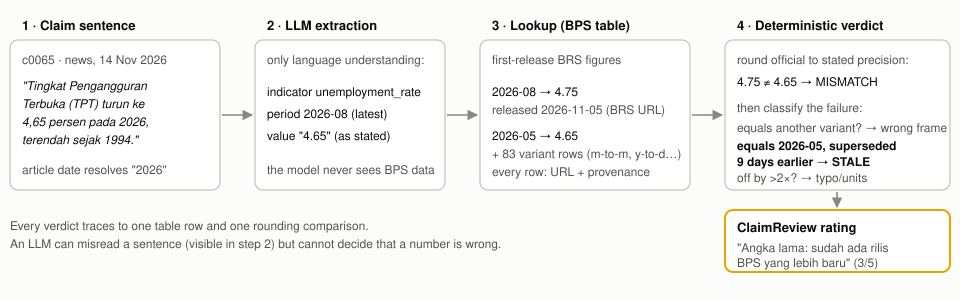
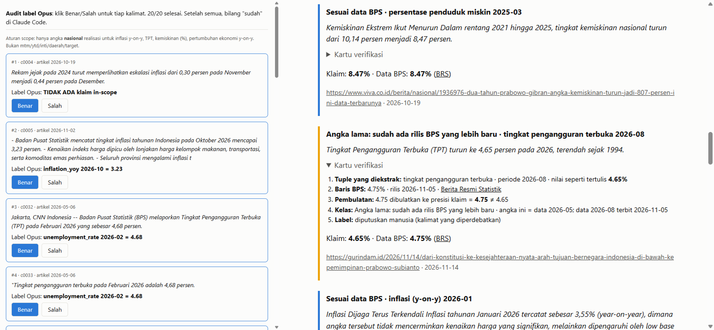

# Do Their Numbers Match? Checking Indonesian Statistical Claims Against Official BPS Data, and What Goes Wrong When They Don't

**Pugar Huda Mantoro** · Universitas Islam Indonesia — with Apart Research · AI x Epistemics Research Sprint, November 2026

**Abstract.** Indonesian officials and media routinely attribute headline statistics to Statistics Indonesia (BPS). We ask:
- how many such claims can be bound automatically to the official figure;
- how many disagree with it;
- how reliably language models do the binding.

We collected 166 claim sentences from ministry releases and national news, and built an evidence table of 104 first-release BPS figures (2022–2026, each with its release URL and date). We added a second table of 83 *variant* figures from the same releases. An LLM only extracts (indicator, period, value). The verdict is a deterministic, precision-aware comparison, so it is auditable and cannot be hallucinated.

**Findings.**
- 95.7% of claims are bindable, and 2.2% of those mismatch (95% CI 0–5.7). Neither mismatch is an official misquoting BPS: one is a *stale* figure in a news article, the other a typo.
- The errors that matter are not wrong numbers. They are **right numbers in the wrong frame** (month-on-month presented as inflation), **stale numbers**, and **wrong periods**.
- On sentences where models disagreed with the reference labeller, a human decided, and no labeller, frontier models included, matched the human on more than 2 of 7.
- Batched prompting leaked values between items.

We turn these failure types into schema.org ClaimReview ratings fact-checkers can publish, and keep the evidence table current with a monthly job.

## 1. Introduction

Statistical claims are unusually checkable: "unemployment fell to 4.65 percent" has one authoritative counterpart, published by a national statistics office on a known date. Checking is still slow, because the checker must first decide three things:
- *which* statistic is meant (year-on-year or month-on-month? national or provincial?);
- *which* release (often implied only by the article date);
- *how much* rounding is acceptable.

These are the steps where an automated fact-checker can fail silently. When it fails it produces the most damaging error in fact-checking: a false accusation against a named official.

We study this for Indonesia. BPS publishes every headline figure in a *Berita Resmi Statistik* (BRS) release with a stable URL, and government communication cites BPS constantly. We fix the research question before collecting data: *Of quantitative claims by Indonesian officials and institutions that cite BPS, what fraction can be bound automatically to an official figure, what fraction mismatch, and how accurately do LLMs do the binding?*

**Contributions:**
1. **An auditable checking pipeline.** LLMs only extract; a precision-aware rule decides against a versioned evidence table with per-row provenance. All parts are tested and open.
2. **A failure taxonomy for statistical claims.** It separates wrong frame, stale figure, implausible value and wrong number, and detects each automatically from BPS's own release data. It is exported as a four-level ClaimReview rating.
3. **Evidence on where LLM fact-checking breaks.**
   - Period resolution, not arithmetic.
   - Ambiguous sentences, where no model reaches a human decision on more than 2 of 7.
   - LLM-as-judge behaviour that differs by model.
   - Cross-item leakage under batched prompting.
4. **An Indonesian dataset and benchmarks**:
   - 166 sentences;
   - adjudicated labels;
   - two synthetic benchmarks with known answers (105 easy, 39 hard).

## 2. Related Work

**Numerical fact-checking benchmarks.** QuanTemp [1], earlier released as NUMTEMP, collects real-world numerical, statistical and temporal claims from fact-checking sites and pairs them with web evidence. Its best baselines reach a macro-F1 of about 58. CLEF CheckThat! 2025 Task 3 [2] uses QuanTemp with BM25-retrieved evidence.

All of them are in English, retrieve prose evidence, and let the model produce the verdict. We instead use a small *structured* evidence table from the statistics office and a *deterministic* verdict, so every error is attributable to extraction, to the table, or to the rule. We also work in Indonesian.

**Fact-checking infrastructure.** ClaimReview [3] is the schema.org markup that fact-checkers embed and Google Fact Check Explorer reads. Indonesia's collaborative CekFakta network (22 outlets with Mafindo) [4] and AJI's ClaimReview guidance [5] make it the natural output format.

Existing ratings are true/false scales. Our failure taxonomy adds the distinctions a statistics desk actually needs: a correct number in the wrong frame, or an outdated number.

## 3. Methods

**Claims.** We searched for Indonesian articles and press releases stating the four indicators together with BPS attributions ("menurut BPS"). Of 55 URLs, 41 yielded sentences that mention an indicator and a percentage: 166 sentences, 164 after removing duplicates. For the 25 sentences from the Coordinating Ministry for Economic Affairs (ekon.go.id), dates were recovered from the release dateline. Sampling on BPS attribution over-represents claims that quote BPS correctly, so our mismatch rate applies to attributed claims only.

**Evidence.** `bps_reference.csv` holds 104 national first-release figures (2022–2026): headline inflation y-on-y, open unemployment (TPT), poverty rate and GDP growth. Each row carries its BRS URL, whose path also gives the release date. 68 values were read on the BRS page in a browser and 31 from listing titles. An independent second pass re-opened 12 rows and found all 12 correct, in the right frame (y-on-y, not the q-to-q figure in the same release). `bps_variants.csv` holds 83 other figures from the same releases (m-to-m and y-to-d inflation, q-to-q and c-to-c growth), each quoting its evidence sentence.

**Pipeline** (Figure 1).
1. **Extraction.** The extractor reads the sentence, the preceding sentence and the article date, and returns in-scope tuples (indicator, period, value as stated). Scope excludes m-to-m, y-to-d, core and regional figures, and targets.
2. **Lookup** on (indicator, period).
3. **Verdict.** UNVERIFIABLE if the period is unknown or absent from the table; otherwise MATCH iff `round_half_up(official, d) = stated`, where *d* is the number of decimals stated. Tests caught two traps in a naive version: `round(5.05, 1) = 5.0` in Python, and JSON parsing that turns "5,0" into "5".
4. **Failure class.** Each MISMATCH is classified, in order: **wrong frame** (it equals a variant of the same release), **stale** (it equals an earlier release that a newer one superseded before the article date), **implausible** (off by more than a factor of 2: units or typo), else **wrong number**.

**Figure 1.** The pipeline on a real claim (c0065). The model only reads language. Lookup, verdict and failure class come from BPS data, so the stale-figure diagnosis cites the release that superseded the number.

**Systems.**
- **Free API models** (temperature 0, batched 20 per request to fit the 50-request/day quota): Nemotron-3 Ultra 550B, ERNIE 5.5 Flash, LFM-3 1.7B, Gemini 3.8 Flash.
- **Claude Sonnet 5.5 and Haiku 5.5**, run as isolated Claude Code subagents that saw only the instructions and the sentences. This is less reproducible than an API run.
- **Rule baselines**: a naive regex, and `rules`, which adds clause-level scope cues and relative periods.
- **LLM-as-judge ablation (e2e)**: the model gets the whole evidence table and returns the verdict itself.

**Reference labels.** A blind Claude Opus subagent annotated all 164 sentences (94 tuples) from written guidelines. A human then decided every sentence where the systems' majority disagreed with the annotator (7), and audited 20 random sentences where all systems agreed with it (§4.3). A tool pass over all rows in which the human changed nothing is not counted as gold.

**Metrics.**
- Bindable and mismatch rates, with 95% bootstrap CIs over sentences.
- Extraction F1, verdict accuracy and macro-F1.
- **False MISMATCH** (a false accusation).
- A grounding check: does the extracted value occur in the source text?
- Cohen's κ between systems.

**Synthetic benchmarks** (known answers, built from the tables):
- **Easy (105).** Exact, rounded, truncated, last digit +1, off by 0.5, wrong period, absent period.
- **Hard (39).** "Bulan lalu" resolved from the article date, the previous month's figure under "bulan lalu", a stale figure under "data terbaru", and an unlabelled m-to-m figure.

## 4. Results

### 4.1 How many claims are checkable, and how many are wrong?

**95.7% of claim tuples are bindable** (90/94, CI 91.1–99.1), and **2.2% of bindable tuples mismatch** (2/90, CI 0.0–5.7).

| Speaker / source | Tuples | Bindable | Mismatch |
|---|---|---|---|
| Government officials | 42 | 93% | **0/39** |
| BPS officials | 32 | 100% | 0/32 |
| Journalists / others | 19 | 89% | 2/17 |
| News media (all speakers) | 83 | 96% | 2/80 |

**Table 1.** Reference labels after human adjudication (`results/metrics.md`).

Neither mismatch is an official misquoting BPS. The failure taxonomy names both from BPS data alone:
- **Stale (c0065).** A news article on 14 Nov 2026 reports "TPT 4,65 persen pada 2026". That was the May figure, and BPS had published the August figure (4.75) nine days earlier.
- **Implausible (c0137).** Poverty is given as "23,85%" for "Meret 20025". This is a typo for 23.85 *million people*.

Within this sample, attributed government claims match BPS. The failures are in reporting.

**Robustness to the period convention** (`results/sensitivity.md`). The human resolved ambiguous periods as "latest release at the article date". We re-ran the headline under two alternative conventions:
- **Strict** (every ambiguous period is undeterminable): bindable 89.4% (CI 81.0–96.4), mismatch 1/84 = 1.2% (only the typo).
- **Lenient** (always the latest release): bindable 96.8%, mismatch 2/91 = 2.2%.

Under all three conventions no official misquotes BPS. The convention moves the bindable rate by about 7 points and decides whether c0065 counts as stale.

### 4.2 Where do systems fail?

| System | Extract F1 | Verdict acc. | Macro-F1 [95% CI] | False MISMATCH | Values not in source |
|---|---|---|---|---|---|
| Claude Sonnet 5.5 † | 0.99 | 0.94 | 0.51 [0.33, 0.62] | 0 | 0 |
| Claude Haiku 5.5 † | 0.99 | 0.93 | 0.51 [0.38, 0.60] | 0 | 0 |
| Gemini 3.8 Flash | 0.99 | 0.87 | 0.68 [0.37, 0.86] | 0 | 0 |
| ERNIE 5.5 Flash | 0.96 | 0.81 | 0.65 [0.35, 0.82] | 0 | **2** |
| Nemotron-3 Ultra | 0.96 | 0.80 | 0.50 [0.36, 0.70] | **7** | 0 |
| rules | 0.63 | 0.30 | 0.30 [0.25, 0.34] | **54** | 0 |
| regex | 0.54 | 0.27 | 0.27 [0.23, 0.33] | **31** | 0 |

**Table 2.** Systems vs the adjudicated reference (164 sentences; LFM-3 1.7B produced output for only 38). † The reference annotator is Claude, so Claude rows are an upper bound. Macro-F1 is unstable with two reference mismatches; we lead with accuracy and false accusations.

**(i) Period, not arithmetic.** The most frequent disagreement for every LLM is the *period* (6–15 per system). On the easy synthetic benchmark every system, including LLM judges with the table in context, scores 100% on all seven perturbation types. Matching a stated number to a table is not the hard part.

**(ii) Right number, wrong frame.** All 7 false accusations by Nemotron come from sentences quoting month-on-month inflation as plain "inflasi". Of its 8 MISMATCHes:
- 5 equal the published m-to-m figure exactly;
- 2 more come from the same sentences but lie outside the variant table's coverage;
- the eighth is the typo the reference also flags.

**(iii) Rules accuse.** Hand-written scope rules raise recall but produce 54 false accusations, more than the naive regex. Encoding the scope as cues does not replace language understanding.

**(iv) Batching leaks.** ERNIE attached 2 of its 95 values to sentences that do not contain them. Both values appear verbatim in *neighbouring sentences of the same 20-item batch*. A 10-sentence batch-size test (identical outputs, κ = 1.0) did not reveal this; the grounding check did. The pipeline now flags every ungrounded value.

### 4.3 Can LLM labels replace a human?

| Labeller | 7 disputed sentences | 20 random agreed sentences |
|---|---|---|
| Claude Opus (reference annotator) | 2/7 | **20/20** (95% CI 84–100%) |
| Claude Sonnet 5.5 | 2/7 | – |
| Gemini, ERNIE, Nemotron | 1/7 each | – |
| Claude Haiku 5.5 | 0/7 | – |

**Table 3.** Exact agreement with a human decision. The disputed sentences are genuinely ambiguous about the period, e.g. "TPT 4,65 persen pada 2026" when BPS publishes no annual TPT. The human chose "latest release at the article date".

When sentences are ambiguous, no labeller, frontier models included, exceeds 2/7. On a random sample of 20 sentences where all systems agreed with the annotator (14 with claims, 6 without), the human found **no error (20/20; Wilson 95% CI 83.9–100%)**. The audit showed the label, so anchoring is possible (`data/human_audit_agreed.csv`).

Together, the two audits locate the weakness of LLM labels precisely. Where models agree, the labels are reliable. Where they disagree, the sentence is usually ambiguous about the *period*, and there LLM labels are close to useless (≤2/7). A cheap protocol follows: let an LLM label everything, route disagreements to a human, and spot-audit the rest.

### 4.4 Should the LLM judge with the evidence in view?

| Model | κ pipeline vs e2e | Accuracy pipeline → e2e | False MISMATCH pipeline → e2e |
|---|---|---|---|
| Gemini 3.8 Flash | 0.91 | 0.87 → 0.88 | 0 → 0 |
| ERNIE 5.5 Flash (124 sentences) | 0.90 | 0.81 → 0.87 | 0 → 0 |
| Nemotron-3 Ultra | 0.68 | 0.80 → 0.85 | 7 → 0 |

**Table 4.** The LLM-as-judge effect differs by model. Gemini e2e covers 146/166 sentences.

With the answer key in context, Nemotron stops reading month-on-month figures as year-on-year, and its 7 false accusations disappear. Two other models barely change.

On the hard benchmark (stale figures, relative periods), every LLM scores 95–97% and the rule baseline 74%. The rule baseline fails every stale case: it cannot tell what "data terbaru" refers to. All three LLMs fail the *same* stale item. On 8 Aug 2026, "data terbaru … TPT 4,68 persen" is the February figure, but BPS had already published the May 2026 rate. Claude Sonnet, Claude Haiku and Gemini 3.5 Flash all labelled it February and called it a MATCH. Since 2025, BPS has published unemployment quarterly; the models apply the older February/August calendar from their training data. The judge version (Gemini e2e, with the table in context) misses one more stale case. A release calendar read from the evidence itself (our table takes release dates from BRS URLs) is what catches these. Gemini 3.8 Flash had reached its free daily quota, so Gemini 3.5 Flash was used here (Appendix B).

The deterministic design keeps every extraction visible, so a judge that "reconciles" a speaker's number with the table can be audited instead of trusted.

## 5. Discussion and Limitations

**Implications.** For epistemic tools built on LLMs, the failure that matters is rarely a wrong number. It is *which statistic* and *which release*: precisely the judgements a reader also gets wrong. Separating extraction from judgement makes those failures visible. Grounding checks catch a failure mode that aggregate accuracy hides: values borrowed from other items. A fact-checker gets a richer, more honest output than true/false:
- **"right number, wrong frame"**;
- **"stale: a newer release exists"**.

**Stale figures are a distinct kind of misinformation.** A stale figure is neither a lie nor an error: it was true when first published. It misleads because the world moved on and the sentence did not. Fact-checking scales that offer only true or false force a choice between "true" (misleading) and "false" (unfair). Automated checkers make this worse. They rely on a release calendar from their training data, and all three LLMs we tested assumed BPS's old February/August unemployment calendar (§4.4). An evidence table that records *when* each figure was released is what makes staleness detectable.

We ship both as ClaimReview ratings. The public page (https://pugarhuda.github.io/bps-claims-check/claimreview.html) publishes only the 24 claim reviews from sentences a person decided or audited. It validates against schema.org with 0 errors. Each review opens a *verification card* that shows the full chain: the sentence, the extracted tuple, the BRS row and its release date, the rounding comparison, the failure class, and who checked the label (Appendix C).

**Limitations.**
1. **Reference labels are mostly LLM labels.** A human decided all disputed sentences and audited a random sample of agreed ones. Errors shared by every system and the annotator could still be missed.
2. **Small n with two mismatches**, so CIs are wide. Sampling on BPS attribution means our "officials 0/39" does not generalise to unattributed claims.
3. **Free endpoints only.** Claude runs were subagents, not API calls. LFM-3 1.7B (38/166) and two e2e runs (ERNIE 126, Gemini 146) are incomplete.
4. **Evidence scope:** first-release values, national, four indicators. Three periods are missing or weakly sourced.
5. **The human's period convention** decides some verdicts. We report how the headline moves under strict and lenient alternatives (§4.1).

**Future work.**
- Unattributed claims: speeches, debates, social media.
- More indicators, and regional BRS releases.
- A second human annotator.
- Partnering with a CekFakta member to publish the ClaimReview feed.

## 6. Conclusion

Attributed headline statistics in Indonesian government communication largely match BPS. The few mismatches we found are reporting failures: a stale figure and a typo. Automated checkers fail in different places: frame, period, and leakage between batched items. None of these show up as "wrong numbers".

A pipeline that lets the model read but not judge, and that classifies failures against the statistics office's own release data, turns these into specific verdicts that are auditable and publishable.

## Code and Data

- **Code, data, results, tests (16), CI:** https://github.com/PugarHuda/bps-claims-check
- **Reproduce:** `README.md`. Every number in this report is in `results/*.md`.
- **Public ClaimReview page** (human-checked verdicts only): https://pugarhuda.github.io/bps-claims-check/claimreview.html
- **Monthly evidence update** (`src/update_bps.py`, GitHub Action): a live run on 16 Nov 2026 matched the three newest BPS releases.
- **Raw Claude subagent outputs and exact instructions:** `results/agent_raw/`.

## References

1. *QuanTemp: A real-world open-domain benchmark for fact-checking numerical claims* (earlier version: NUMTEMP). arXiv:2403.17169, 2024. github.com/factiverse/QuanTemp
2. *ClaimIQ at CheckThat! 2025: Comparing prompted and fine-tuned language models for verifying numerical claims.* arXiv:2509.11492.
3. Google Search Central. *Fact check (ClaimReview) structured data.* developers.google.com/search/docs/appearance/structured-data/factcheck
4. Google News Initiative. *CekFakta: collaborative fact-checking in Indonesia.* blog.google, 2018.
5. AJI Indonesia. *ClaimReview: panduan media untuk kredibilitas informasi.* 2025.
6. Badan Pusat Statistik. *Berita Resmi Statistik.* bps.go.id (accessed 16 Nov 2026).

## Appendix A. Dual-use and ethics

**Main harm: false accusation.** A MISMATCH attached to a named official is an accusation. Naive automation produces many: 31–54 false MISMATCHes from the rule baselines. Our mitigations:
- false accusations are reported separately;
- the ClaimReview export defaults to human-checked verdicts and skips UNVERIFIABLE;
- frame and staleness errors get their own ratings, so a correct number is never published as "false".

**Misuse.** A "Sesuai data BPS" stamp could be applied selectively to favourable claims. Publishing the full claim set and all verdicts is the countermeasure. A judge that reconciles claims with the table it sees can hide real misstatements (§4.4), which is a reason to keep extraction and judgement separate.

**Data.** The dataset contains:
- public statements by public officials, stored as short quotations with URLs;
- public BPS figures.

No private individuals or personal data are included. Untrusted scraped text is sanitised before prompting, and labelling sheets are protected against spreadsheet formula injection.

## Appendix B. Synthetic benchmarks

**Easy (105 sentences, 7 kinds).** All five systems scored 100%:
- the deterministic rule given the true tuple;
- `rules`;
- ERNIE;
- the ERNIE e2e judge;
- the Nemotron e2e judge.

**Hard (39).**

| System | m-to-m unlabelled | "bulan lalu" | "bulan lalu", wrong month | stale "data terbaru" | Overall |
|---|---|---|---|---|---|
| Oracle (true tuple → rule) | 10/10 | 10/10 | 9/9 | 10/10 | 100% |
| Claude Sonnet 5.5 | 10/10 | 10/10 | 9/9 | 9/10 | 97% |
| Claude Haiku 5.5 | 10/10 | 10/10 | 9/9 | 9/10 | 97% |
| Gemini 3.5 Flash | 10/10 | 10/10 | 9/9 | 9/10 | 97% |
| Gemini 3.5 Flash · e2e judge | 10/10 | 10/10 | 9/9 | 8/10 | 95% |
| rules | 10/10 | 10/10 | 9/9 | 0/10 | 74% |

**Table B1.** Hard synthetic benchmark (`results/perturb_hard_metrics.md`). Expected verdicts follow the rule "latest release at the article date"; for unlabelled m-to-m figures, anything but a year-on-year MATCH is accepted.

## Appendix C. Prompts and tooling

The extraction prompt is in `src/pipeline.py` (`PROMPT`, `BATCH_PROMPT`, `E2E_PROMPT`). The labelling tool `tools/label.html` was tested end to end with Playwright (17 checks). The audit tool `tools/audit.html` recorded the 20-sentence audit.

**Figure C1.** Human in the loop. *Left:* the audit tool with the 20 recorded answers (all "Benar"; the label was shown). *Right:* the public ClaimReview page, with c0065's verification card open. The card shows the extracted tuple, the BRS row and its release date, the rounding comparison, the stale classification, and that a human decided the label.

## LLM Usage Statement

We used Claude (Anthropic) extensively as a coding and writing assistant. It helped:
- implement the pipeline, tests and figures;
- collect and verify BPS figures in a browser;
- draft this report.

Claude models also appear *as evaluated systems* (Sonnet, Haiku) and as the *reference annotator* (Opus). We disclose this throughout and do not count LLM labels as human gold. All numbers were produced by scripts in the repository, and the human author made the adjudication decisions.
